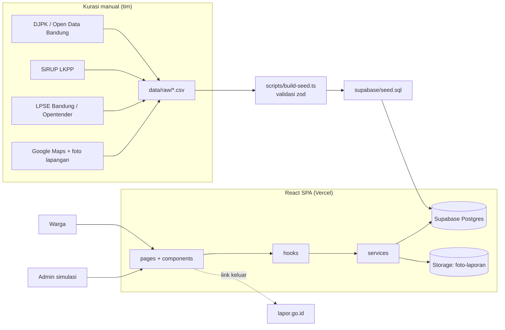

# Architecture — Jejak Anggaran

## Gambaran umum

SPA React (Vite) yang berbicara langsung ke Supabase. Tidak ada server backend terpisah. Aturan akses ditegakkan dengan Row Level Security (RLS) di Postgres. Data resmi masuk lewat pipeline kurasi manual (CSV → seed SQL), bukan scraping.



## Struktur direktori

```
jejak-anggaran/
├── CLAUDE.md
├── PRD.md
├── Architecture.md
├── .env.example
├── vercel.json                 # rewrite semua route → index.html
├── data/
│   └── raw/
│       ├── anggaran_daerah.csv # tahun, urusan, anggaran, realisasi, sumber_nama, sumber_url, diakses_pada
│       ├── proyek.csv          # satu baris per paket, kolom = tabel proyek (id slug, lat/lng, URL sumber, diakses_pada, foto_path)
│       └── laporan_demo.csv    # proyek_id, kategori, deskripsi, status, hari_lalu, foto_path, catatan_status (hanya proyek is_demo)
├── scripts/
│   ├── build-seed.ts           # CLI: baca CSV → seedLib → tulis supabase/seed.sql (dijalankan Node langsung)
│   ├── seedLib.ts              # validasi CSV (zod) + aturan demo + pembuatan SQL (murni, ada test)
│   └── sinkronAturan.test.ts   # menjaga redFlag.ts/statusLaporan.ts sinkron dengan SQL migrasi
├── supabase/
│   ├── config.toml
│   ├── migrations/             # file SQL berurutan, jangan diedit setelah di-push
│   └── seed.sql                # HASIL GENERATE, jangan diedit manual
├── public/
│   └── foto-proyek/            # foto lapangan tim; dirujuk kolom proyek.foto_path (/foto-proyek/…)
└── src/
    ├── main.tsx
    ├── App.tsx                 # router + layout + ErrorBoundary per route
    ├── pages/
    │   ├── BerandaPage.tsx     # F1 dashboard anggaran
    │   ├── PetaPage.tsx        # F2 peta + daftar proyek (alternatif aksesibel)
    │   ├── ProyekDetailPage.tsx# F3, F6, F7, F8, F9
    │   ├── LaporPage.tsx       # F4 form laporan (/proyek/:id/lapor)
    │   ├── TentangDataPage.tsx # F5
    │   ├── MasukPage.tsx       # login Supabase Auth
    │   └── AdminPage.tsx       # verifikasi + ubah status (peran admin)
    ├── components/
    │   ├── ui/                 # Button, Badge, Card, Skeleton, EmptyState, ErrorState
    │   ├── SumberData.tsx      # badge sumber + tanggal akses + link (wajib di tiap angka)
    │   ├── BadgeDemo.tsx
    │   ├── BadgeRedFlag.tsx
    │   ├── BadgeStatus.tsx     # badge status proyek & status laporan
    │   ├── PetaProyek.tsx      # react-leaflet
    │   ├── GrafikAnggaran.tsx  # Recharts (tren) + batang HTML (per urusan)
    │   ├── LinimasaFoto.tsx
    │   ├── LinimasaStatus.tsx  # audit trail
    │   ├── KartuLaporan.tsx    # satu laporan: foto, konfirmasi (F6), riwayat (F8), LAPOR! (F9)
    │   ├── TeruskanKeLapor.tsx # F9: ringkasan siap salin + link lapor.go.id
    │   ├── Layout.tsx          # Navbar, footer, ErrorBoundary + Suspense per route
    │   ├── Navbar.tsx          # pita "situs warga independen" + menu + tombol Lapor
    │   ├── Footer.tsx          # blok merek + link LAPOR!, 3 kolom tautan (jelajahi, tentang data, sumber resmi), hak cipta
    │   ├── HeroBanner.tsx      # banner navy rounded + lekukan breadcrumb
    │   ├── SeksiPengantar.tsx  # teks kiri atas + kolase foto tersebar (grid 12x8, tanpa celah tengah, tanpa CTA), lalu dua kolom "Fokus Kami"
    │   ├── SeksiProyek.tsx     # Beranda: maks 6 proyek sorotan (perlu perhatian dulu) + tautan ke peta
    │   ├── KartuProyek.tsx     # kartu proyek: teks di atas, foto lapangan / cuplikan peta di bawah, aksen merah bila perlu perhatian
    │   ├── CuplikanPeta.tsx    # peta statis tile OSM berpusat di lokasi proyek (+ atribusi wajib)
    │   ├── SeksiLayanan.tsx    # (tidak dipakai lagi) 8 kartu fitur; diganti SeksiProyek di Beranda
    │   ├── AuthProvider.tsx
    │   └── ErrorBoundary.tsx
    ├── hooks/                  # useMuat (dasar), useProyekList, useProyekDetail, useAnggaran, useAuth, ...
    ├── services/               # SATU-SATUNYA tempat memanggil Supabase (dijaga aturan ESLint)
    │   ├── supabaseClient.ts
    │   ├── authService.ts      # magic link, pantau sesi, peran
    │   ├── proyekService.ts
    │   ├── anggaranService.ts
    │   ├── laporanService.ts   # buat laporan, upload foto, konfirmasi
    │   └── adminService.ts     # ubah status
    ├── lib/
    │   ├── errors.ts           # AppError + pemetaan error Supabase
    │   ├── logger.ts
    │   ├── format.ts           # formatRupiah, formatRupiahRingkas, formatTanggal
    │   ├── redFlag.ts          # ambang red flag (sinkron dengan view SQL)
    │   ├── kompresFoto.ts      # canvas → WebP (fallback JPEG), buang EXIF
    │   ├── statusLaporan.ts    # transisi status (sinkron dengan transisi_status_valid)
    │   ├── wilayah.ts          # batas & kecamatan Kota Bandung (dipakai juga oleh scripts/)
    │   ├── label.ts, anggaran.ts, filterProyek.ts, ringkasanLapor.ts
    │   ├── petaTile.ts         # hitung tile Web Mercator untuk CuplikanPeta (diuji terhadap proyeksi Leaflet)
    │   └── schemas.ts          # skema zod form
    ├── types/
    │   └── database.ts         # hasil `supabase gen types`
    └── test/                   # setup Vitest + test util & komponen kunci
```

## Model data

| Tabel / view | Kolom penting | Catatan |
| --- | --- | --- |
| `sumber_data` | id, nama, url, diakses_pada | Direferensikan semua data resmi |
| `anggaran_daerah` | tahun, urusan, anggaran, realisasi, sumber_id | Untuk F1 |
| `proyek` | id (slug teks), kode_rup, nama_paket, satker, kecamatan, kelurahan, pagu, nilai_kontrak, pelaksana, tahun_anggaran, status_proyek, lat, lng, sumber_rup_url, sumber_lpse_url, diakses_pada, is_demo, foto_path | `status_proyek`: direncanakan / berjalan / selesai. Data nyata wajib punya `sumber_rup_url` + `diakses_pada` (check constraint) |
| `profiles` | id (= auth.users.id), nama_tampilan, peran | `peran`: warga / admin. Dibuat trigger saat daftar; peran tidak bisa diubah sendiri |
| `laporan` | id, proyek_id, pelapor_id, kategori, deskripsi, foto_path, status, catatan_status, is_demo, created_at, updated_at | `kategori`: kerusakan / belum_dikerjakan / tidak_sesuai / lainnya. `pelapor_id` null hanya untuk demo. `catatan_status` diisi admin bersama perubahan status |
| `konfirmasi` | laporan_id, warga_id, created_at | Primary key (laporan_id, warga_id) |
| `riwayat_status` | id, laporan_id, status_lama, status_baru, diubah_oleh, catatan, created_at | Diisi trigger. `diubah_oleh` hanya terisi untuk perubahan admin (pelapor tidak pernah tercatat) |
| `v_laporan_publik` | semua kolom laporan kecuali pelapor_id + jumlah_konfirmasi | Yang dibaca halaman publik |
| `v_red_flag_proyek` | proyek_id, jumlah_laporan, alasan | Aturan F7 |

## Aturan akses (RLS)

| Tabel | Baca | Tulis |
| --- | --- | --- |
| sumber_data, anggaran_daerah, proyek | Publik | Hanya lewat migrasi/seed |
| laporan | Publik lewat `v_laporan_publik` | Insert: warga login, `pelapor_id = auth.uid()`. Update status: admin |
| konfirmasi | Publik (jumlah) | Insert: warga login, bukan pelapor laporan tersebut |
| riwayat_status | Publik | Hanya trigger |
| Storage `foto-laporan` | Publik | Upload: warga login, ke folder `{auth.uid()}/` |

## Alur data utama

1. **Baca (pengunjung):** page → hook → service → `select` ke tabel/view publik → `AppError` jika gagal → UI menampilkan state memuat/kosong/error.
2. **Lapor (warga):** form → validasi zod → `kompresFoto` → upload ke Storage → insert `laporan` (status `diterima`). Jika insert gagal setelah upload berhasil, service menghapus foto yatim.
3. **Konfirmasi:** insert `konfirmasi`. Constraint unique mencegah duplikat, RLS mencegah konfirmasi diri sendiri.
4. **Ubah status (admin):** update `laporan.status` + `catatan_status` → trigger memvalidasi transisi (`transisi_status_valid`) lalu menulis `riwayat_status` → tampil di `<LinimasaStatus>`.
5. **Red flag:** dihitung di view `v_red_flag_proyek` saat dibaca. Tidak ada job terjadwal.
6. **Teruskan ke LAPOR!:** link keluar ke lapor.go.id. Tidak ada pengiriman data otomatis.

## Pipeline data

1. Tim mengisi `data/raw/*.csv` dari sumber resmi, dengan URL sumber dan tanggal akses di setiap baris.
2. `npm run data:seed` memvalidasi tipe, koordinat dalam batas Kota Bandung, nama kecamatan, URL sumber wajib untuk baris non-demo, duplikat, dan aturan laporan demo hanya pada proyek demo, lalu menulis `supabase/seed.sql`.
3. `supabase db reset` (lokal) atau eksekusi seed ke remote sebelum demo. Seed aman diulang: data resmi di-upsert, hanya laporan `is_demo` yang dihapus dan dibuat ulang (tanggalnya relatif terhadap `now()` lewat kolom `hari_lalu`, jadi red flag demo tetap berada di jendela 90 hari).